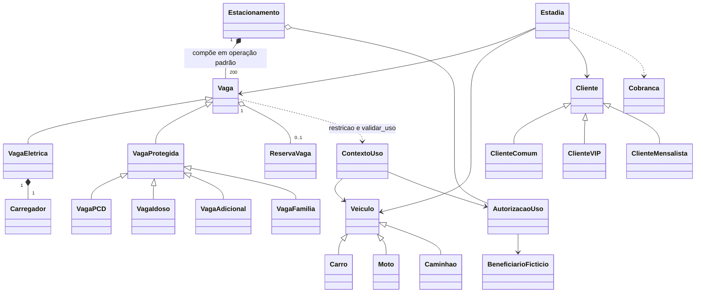
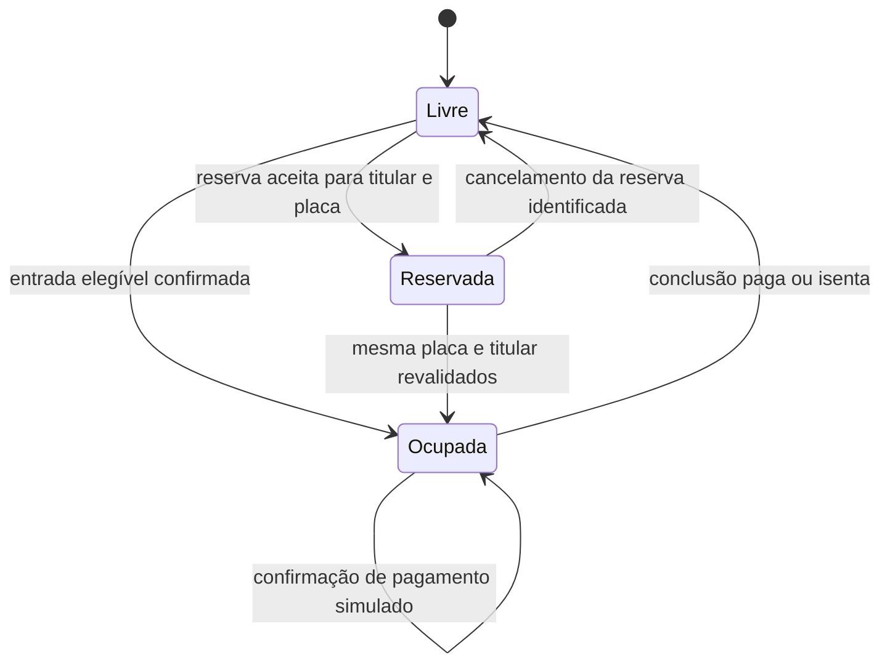

# MOVE 2.0 · Estacionamento com 200 vagas

Adendo ao trabalho de Programação Orientada a Objetos. O percurso de demonstração combina reserva, conferência administrativa, entrada, pagamento simulado e consulta do comprovante pelo titular. As páginas e os exemplos usam dados fictícios.

## Capacidade e decisões de projeto

| Identificadores apresentados | Classificação permanente | Quantidade | Participação |
|---|---|---:|---:|
| 001–116 | Comum | 116 | 58% |
| 117–176 | Recarga elétrica | 60 | 30% |
| 177–180 | Exclusiva PcD | 4 | 2% |
| 181–190 | Pessoa idosa | 10 | 5% |
| 191–194 | Acessibilidade adicional para PcD ou pessoa obesa | 4 | 2% |
| 195–200 | Gestante ou pessoa acompanhada de criança de colo até dois anos | 6 | 3% |
| **001–200** | **Total** | **200** | **100%** |

Os dez setores organizam a consulta em grupos de vinte. A apresentação acrescenta zeros à esquerda. Os identificadores persistidos continuam inteiros. A destinação VIP utiliza uma das 116 vagas comuns e dura uma reserva ou estadia. A indisponibilidade operacional por reserva ou ocupação é calculada separadamente da possibilidade de oferecer recarga.

## Fundamentos e abrangência

- **PcD.** A Lei Brasileira de Inclusão, art. 47, prevê 2% das vagas, com pelo menos uma, para veículos que transportem pessoa com deficiência com comprometimento de mobilidade. Abrange os estacionamentos abertos ao público, de uso público ou privado de uso coletivo, e as vias públicas. Também trata de localização e sinalização. O modelo separa quatro vagas exclusivas. [Lei nº 13.146/2015, art. 47](https://www.planalto.gov.br/ccivil_03/_ato2015-2018/2015/lei/l13146.htm)
- **Pessoas idosas.** O Estatuto da Pessoa Idosa, art. 41, prevê 5% nos estacionamentos públicos e privados, nos termos da lei local, com localização que proporcione comodidade. Em Porto Alegre, a Lei nº 10.365/2008 assegura o mínimo de 5% nos estacionamentos públicos e privados. Dez vagas representam 5% de 200. [Lei nº 10.741/2003, art. 41](https://www.planalto.gov.br/ccivil_03/leis/2003/l10.741compilado.htm) · [Lei municipal nº 10.365/2008](https://legislacao.portoalegre.rs.gov.br/norma/35335)
- **Beneficiário e credencial.** Para PcD com comprometimento de mobilidade e para pessoa idosa, a regulamentação contempla credencial física ou digital e o transporte do beneficiário. A vinculação digital a um veículo por vez e as condições de utilização da versão impressa são disciplinadas pelo CONTRAN. Na demonstração, a Gestão registra uma conferência fictícia e confirma a presença na entrada. O número interno do beneficiário só tem significado dentro daquele cadastro. Nenhum identificador oficial é coletado. [Resolução CONTRAN nº 965/2022](https://www.gov.br/transportes/pt-br/assuntos/transito/conteudo-contran/resolucoes/Resolucao9652022.pdf) · [Resolução CONTRAN nº 1.012/2024](https://www.gov.br/transportes/pt-br/assuntos/transito/conteudo-contran/resolucoes/Resolucao10122024.pdf)
- **Acessibilidade adicional em Porto Alegre.** A Lei nº 7.768/1996, na redação da Lei nº 12.859/2021, alcança estacionamentos dos estabelecimentos especificados e similares. Reserva pelo menos 2%, com mínimo de uma vaga, para veículos que transportem pessoas com deficiência ou pessoas obesas. O MOVE destina voluntariamente quatro posições adicionais ao grupo compartilhado e conserva as quatro exclusivas PcD. A divisão em dois conjuntos é uma decisão do projeto. [Ficha da alteração](https://legislacao.portoalegre.rs.gov.br/norma/43313) · [Texto publicado no Diário Oficial de Porto Alegre](https://dopaonlineupload.procempa.com.br/dopaonlineupload/4074_ce_333804_1.pdf)
- **Gestantes e crianças de colo em Porto Alegre.** A Lei nº 11.584/2014 estabelece ao menos 3% em estacionamentos mantidos por shopping centers, centros comerciais e hipermercados. Inclui gestantes e pessoas acompanhadas de crianças de colo de até dois anos. O art. 1º, § 2º, prevê identificação por adesivo. A Lei nº 11.789/2015 também trata da sinalização vertical. O software simula a conferência administrativa nesse contexto e separa seis vagas. [Lei municipal nº 11.584/2014](https://legislacao.portoalegre.rs.gov.br/norma/39313) · [Texto do art. 1º](https://legislacao.portoalegre.rs.gov.br/media/sapl/public/normajuridica/sirel/Norma_11584_20140221_1.html) · [Alteração de 2015](https://legislacao.portoalegre.rs.gov.br/norma/39896)
- **Rio Grande do Sul.** O art. 4º da Lei estadual nº 15.253/2019 prevê vagas identificadas para transporte de crianças de colo de até um ano nos estacionamentos internos ou externos de centros comerciais e outras edificações de uso público ou coletivo. O artigo não fixa percentual. A faixa até dois anos e o percentual usados no exemplo provêm do recorte municipal acima. O cadastro oficial identifica a publicação no DOE-RS de 18/01/2019, p. 7. O art. 4º foi consultado em reprodução do texto. [Registro oficial da Assembleia Legislativa do RS](https://www.al.rs.gov.br/legis/M010/M0100018.asp?Hid_IdNorma=65215&Origem=1&Texto=) [Lei estadual nº 15.253/2019, art. 4º](https://leisestaduais.com.br/rs/lei-ordinaria-n-15253-2019-rio-grande-do-sul-estabelece-as-normas-para-a-promocao-da-acessibilidade-de-pessoas-com-mobilidade-reduzida-no-estado-do-rio-grande-do-sul)
- **Recarga e benefício comercial.** Os 60 carregadores simulados e a possibilidade de destinação VIP são requisitos do MOVE. O projeto não atribui cota legal a esses equipamentos. O software modela utilização e elegibilidade. A verificação de dimensões, rotas acessíveis, sinalização, instalação elétrica e licenciamento físico está fora desta demonstração acadêmica.

## Núcleo orientado a objetos



| Responsabilidade | Onde observar |
|---|---|
| Construir a distribuição, encapsular ocupação, reserva e liberação, avaliar a elegibilidade por despacho polimórfico | [Vaga e especializações](../../model/vaga.py). A vaga comum usa o contrato concreto original. Cada vaga elétrica constrói seu carregador. As especializações protegidas declaram os grupos aceitos. |
| Representar conferência válida para o titular e o veículo, identificação local do beneficiário, condutor ou passageiro e data da operação | [Objetos de utilização](../../model/uso_vaga.py) e [agregado Estacionamento](../../model/estacionamento.py). O mesmo cliente pode transportar beneficiários distintos. O registro não exige nome do beneficiário, diagnóstico, laudo ou número de credencial. |
| Revalidar placa, identidade, reserva, equipamento e condição da entrada antes de gravar | [Serviço do estacionamento](../../service/estacionamento_service.py). As projeções pessoais limitam os dados ao titular. A aplicação usa a mesma persistência e as mesmas políticas nos dois portais. |
| Calcular o preço pela classe do veículo e pela categoria histórica da estadia | [Estadia e Cobranca](../../model/estadia.py). Carro custa R$ 10,00/h, moto R$ 5,00/h e caminhão R$ 20,00/h. Comum paga o valor integral, VIP paga metade e Mensalista é isento. A condição elétrica e a destinação da vaga não acrescentam tarifa. |
| Apresentar totais, proporções e páginas em Gestão e Cliente | [OcupacaoViewModel e PaginaVagas](../../web/apresentacao.py), [ConsultasPessoais](../../web/consultas_pessoais.py) e [componentes Jinja2](../../web/templates/components/vagas.html). Alterar a placa no navegador atualiza a consulta HTTP. A decisão de elegibilidade é feita no servidor. |

### Estados e invariantes



A soma de livres, reservadas e ocupadas é 200. Ocupação física usa apenas veículos presentes. Indisponibilidade por utilização soma reservas e ocupações. Uma vaga elétrica pode estar fisicamente livre e ter equipamento indisponível. Só entra no indicador de recarga disponível quando estiver livre e o carregador estiver operacional. Elétricos e híbridos plug-in são elegíveis. A motorização desconhecida de registros antigos impede oferecer recarga.

VIP e Mensalista podem solicitar destinação VIP em vaga comum livre. Uma redução de categoria anterior à entrada exige revalidação. Depois da entrada, a estadia conserva as condições originais. O cancelamento ou a conclusão libera a vaga comum. Permanecem os valores simulados de upgrade de R$ 250,00 do Comum ao VIP, R$ 250,00 do VIP ao Mensalista e R$ 500,00 do Comum ao Mensalista. Reduções são gratuitas e sem reembolso.

### Persistência e leitura de versões anteriores

O arquivo JSON operacional continua sendo o histórico ordenado de eventos. As novas operações registram conferência, revogação, alteração do carregador e informações de reserva e entrada. As operações persistidas mantêm identificadores e vínculos originais. A reconstituição avalia uma utilização protegida na data registrada no evento. Uma revogação posterior pode impedir uma nova entrada e não invalida o passado. A conclusão da saída também permanece disponível se o equipamento falhar durante a estadia.

A leitura preserva as vagas antigas 1–10. Motorização omitida é projetada como desconhecida. Eventos antigos sem classificação histórica continuam sem essa informação. A variante explícita de dez vagas existe para repetir os cenários históricos de lotação, ocupação e cobrança. A configuração padrão de produção monta as 200 vagas.

Antes da intervenção, a suíte da árvore de trabalho passou com 202 testes e foi feita uma cópia privada das alterações locais. Uma demonstração pré-existente de 20 eventos foi carregada em memória com a nova capacidade. A sequência reconstruída coincidiu com a original e a comparação do arquivo antes e depois da leitura confirmou os mesmos bytes. O cenário ampliado é inicializado em diretório próprio.

## Roteiro para o professor

1. Entre como **Master Demo** e abra **Gestão → Mapa de vagas**. Busque **176** para ver o equipamento indisponível. Use os filtros de setor, estado e classificação. Cada página apresenta até vinte posições.
2. Alterne para **Cliente → Disponibilidade**. Selecione **EV200** e a classificação **Exclusiva PcD**. Reserve **177**. A ficha de Lia Vale contém uma conferência fictícia de passageiro para esse veículo.
3. Volte à **Gestão → Registrar entrada**, escolha Lia Vale e alterne entre **EV200** e **HB200**. A primeira placa oferece a reserva **177** e a segunda oferece a reserva elétrica **120**. Selecione EV200 e confirme a presença do beneficiário na revisão.
4. Em **Estadias ativas**, abra a estadia de EV200 e informe **1,225 hora**. A tarifa-base é R$ 12,25, o desconto exato é 6,125 reais e o valor definitivo é **R$ 6,13**. Confirme o pagamento simulado. A vaga continua ocupada. Conclua a saída e abra o histórico e o comprovante pelo portal pessoal.
5. Em **Cliente → Disponibilidade**, confira a reserva VIP da **CM200 na 016**. Cancele e consulte a vaga na Gestão. A capacidade permanece 200 e a identificação VIP se encerra. Para comparar os grupos, a fixture traz conferências para PcD, idoso, acessibilidade adicional e criança de colo. A ficha na Gestão permite simular nova conferência ou revogação.
6. Em **Cliente → Meus veículos**, cadastre mais de um veículo e indique a motorização. Em **Tarifas e benefícios**, faça uma mudança simulada de categoria e consulte o histórico da compra. Use um veículo fora do estacionamento para consultar as vagas reserváveis.

No início do cenário existem **194 vagas livres, três reservadas e três ocupadas**. Das sessenta elétricas, uma está reservada e uma livre está com avaria. Restam **58** vagas em que é possível prometer recarga. Há uma destinação VIP temporária. Os dados evoluem à medida que o professor realiza as operações.

Para criar e conservar um cenário separado, abra um terminal na raiz do projeto com a venv do MOVE ativa. O diretório pai deve existir. O programa pede senhas com entrada oculta na primeira execução. O parâmetro `--novo` exige um destino inexistente.

```shell
python -B -m web.cenario_inteligente "$HOME/MOVE-avaliacao-200" --novo --porta 5012
```

Para retomar o mesmo histórico e as mesmas contas, execute o comando sem `--novo`. Abra [o login local](http://127.0.0.1:5012/entrar). Ctrl+C encerra o processo. Para usar o terminal sobre esse cenário no Linux ou macOS, encerre o servidor e execute `MOVE_HISTORICO="$HOME/MOVE-avaliacao-200/historico.json" python -B main.py`. A opção 8 consulta setores, a 16 registra entrada identificada com beneficiário, a 18 permite cotar, pagar e concluir a saída e a 4 salva e encerra. O bloqueio entre processos protege o mesmo histórico. O terminal é uma interface local administrativa para o operador com acesso ao diretório de dados. A autorização por papel é aplicada aos portais web. No Windows, forneça ao módulo Python um caminho privado nativo e configure a variável pelo shell utilizado.

## Matriz de validação e evidências

O [checkpoint funcional da ampliação](https://github.com/IvoLucasLLJ/sistema-estacionamento-poo/commit/5522349ba47c202a6b31f4cbcbfab46cb46a1b1a) foi conferido localmente com Python 3.14.4 e Chrome 158.0.8127.36. Na consolidação, os 213 testes passaram em 109,873 segundos. O ensaio de instalação abriu duas vezes uma cópia independente e autenticou as três contas em cada abertura. O ensaio responsivo repetiu a jornada nas dez combinações de tamanho e tema e as oito verificações de axe retornaram zero violações nas amostras.

A campanha histórica de estados esperava dez vagas. A consolidação passou a usar explicitamente essa distribuição ao criar e reabrir o serviço em `qa.estados.ciclos`. Foram repetidas as 840 transições, as seis interrupções do cadastro e, em outro ensaio, 230 consultas HTTP da matriz de autorização. Essas contagens descrevem os percursos complementares à suíte. O teste de migração gerou 20 eventos com o código publicado em `3fd8f58` e abriu o mesmo arquivo com o código ampliado. As contagens mudaram de 7 para 197 vagas livres, mantendo as três ocupações, os mesmos UUIDs, os valores e os bytes do histórico.

| Verificação | Evidência |
|---|---|
| Capacidade, 60 equipamentos, limites, todas as classes e lotação física completa | [Regressões do núcleo](../../tests/test_vagas_inteligentes.py). A lotação das 200 posições foi reconstruída a partir do histórico. |
| Autorização, vencimento, revogação, passageiro, revalidação, mesma placa e concorrência | [Regressões do serviço e do portal pessoal](../../tests/test_vagas_inteligentes.py). Incluem negativa de acesso, comparação dos bytes após consulta e geração de 40 passos com invariantes após as transições. |
| Cálculo nas nove combinações, alteração de categoria e reservas | [Fronteiras decimais](../../tests/test_qualidade_10a5.py), [estadias](../../tests/test_estadias.py) e [autosserviço](../../tests/test_autosservico.py). |
| Integração Gestão–Cliente em Chrome | [Ensaio Playwright](../../qa/navegador_vagas_inteligentes.py). Cinco dimensões em cada tema, com toque em tablet e smartphone. Pesquisa, filtros, mudança de placa, reserva protegida, confirmação de presença, pagamento, saída, titularidade e comprovante. No desktop há um percurso adicional de avaria, recuperação, VIP e revogação. |
| Acessibilidade | axe-core no mapa e na reserva em desktop e smartphone, nos dois temas. O ensaio cobre navegação por teclado, nome acessível e rolagem horizontal. As oito verificações de axe-core 4.14.1 retornaram zero violações nas regras executadas. As verificações são amostrais. |
| Terminal | Em histórico temporário, a opção legada recusou a entrada protegida sem confirmação. A opção identificada permitiu a entrada, a cobrança e a saída. O arquivo reaberto registrou 613 centavos e a vaga 177 livre. |
| Instalação e reabertura | O ensaio do inicializador Linux criou ambiente independente, abriu o servidor duas vezes e autenticou as três contas em cada abertura. A verificação comparou os dados persistidos. Os quatro inicializadores originais foram conservados. |
| Regressão global | 202 testes antes da ampliação (54,179 s). A suíte final em Python 3.14.4 passou com 213 testes (77,144 s), incluindo onze regressões desta ampliação. |

Para repetir localmente a partir da raiz do repositório, utilize a venv do produto para a suíte e o ambiente de QA com Playwright para o ensaio. O argumento de axe aponta para uma cópia local de axe-core. As capturas não dependem de serviços externos.

```shell
python -B -m unittest discover -s tests -v
python -m pip check
python -B -m qa.navegador_vagas_inteligentes --chrome /usr/bin/google-chrome --axe /caminho/axe.min.js --capturas /caminho/capturas
```

### Capturas da aplicação

| Tela | Captura |
|---|---|
| Gestão, mapa de vagas com filtros | [Desktop em tema claro](capturas/1440x900-light-mapa.png) |
| Cliente, disponibilidade para reserva | [Tablet em paisagem](capturas/1024x768-light-reserva.png) · [Tablet em retrato](capturas/768x1024-dark-reserva.png) · [Smartphone em tema escuro](capturas/390x844-dark-reserva.png) |
| Gestão, filtro por destinação temporária | [Vagas VIP no mapa](capturas/1440x900-light-vip.png) |
| Cliente, utilização paga | [Comprovante no tema escuro](capturas/1440x900-dark-comprovante.png) |

Os ensaios funcionais anteriores de infraestrutura, Gestão, Cliente e Master Demo também passaram em Chrome 158.0.8127.36. Os históricos de dez vagas foram mantidos explicitamente nos ensaios que reproduzem aquele cenário financeiro.

A [pasta de evidências](capturas/) reúne os 23 PNGs capturados com dados fictícios. As dimensões utilizadas são 1440 × 900, 768 × 1024, 1024 × 768, 390 × 844 e 844 × 390, em pixels CSS. As configurações móveis usam emulação de toque no Chrome.

## Limites da demonstração

As reservas permanecem ativas até uso ou cancelamento. O domínio não estabelece expiração comercial automática. As conferências fictícias têm validade explícita, e as da fixture inicial usam um ano a partir da sua criação. Uma nova conferência pode ser registrada pela Gestão. A revalidação considera a conferência associada à reserva original. Se ela for revogada, o titular pode cancelar e solicitar nova reserva.

O modelo descreve compatibilidade de motorização com a oferta simulada. Não mede energia nem trata de potência, conectores ou preço por kWh. A conferência administrativa simula o contexto de uso, sem consultar bases governamentais ou emitir credenciais. A execução desta versão foi avaliada em Linux. Aparelhos físicos, execução nativa nos demais sistemas e certificação de acessibilidade da interface ou das instalações permanecem fora das evidências desta rodada.
