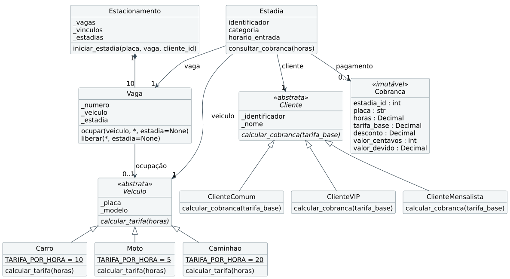
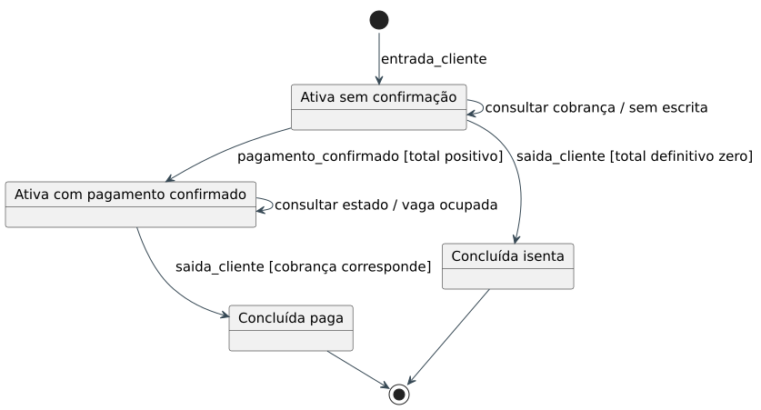
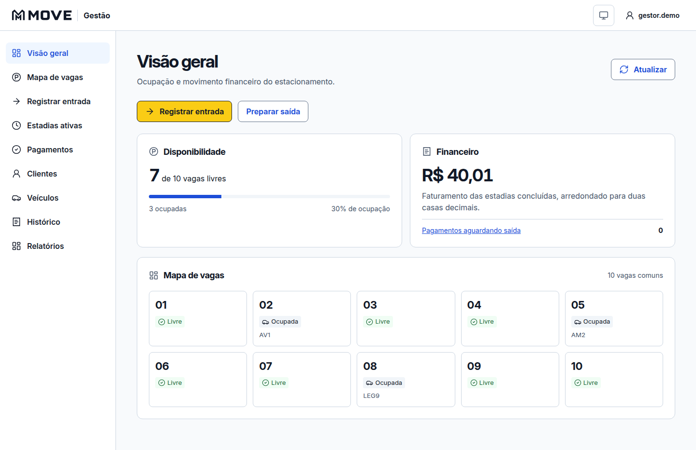

# MOVE

Sistema Inteligente de Estacionamento

Projeto, implementação e validação de uma aplicação fundamentada em Programação Orientada a Objetos

Ivo Lucas de Lima Júnior

Análise e Desenvolvimento de Sistemas

Programação Orientada a Objetos · 2026/2

# Folha de rosto

Ivo Lucas de Lima Júnior

MOVE — Sistema Inteligente de Estacionamento

Relatório técnico apresentado no âmbito do trabalho final da disciplina de Programação Orientada a Objetos, no curso de Análise e Desenvolvimento de Sistemas, semestre 2026/2.

O relatório examina como duas hierarquias de objetos produzem uma cobrança e como o estacionamento conserva essa decisão entre a ocupação e a saída. O atlas UML e a matriz de requisitos acompanham a análise.

### Identificação da versão

Branch trabalho-final. Revisão de encerramento da campanha de qualidade 10A.5.

`fa323dca437853cdd6cd64c1f1c682298dd88ecb`

[Repositório na revisão documentada](https://github.com/IvoLucasLLJ/sistema-estacionamento-poo/tree/fa323dca437853cdd6cd64c1f1c682298dd88ecb) · [Execução oficial da matriz de compatibilidade](https://github.com/IvoLucasLLJ/sistema-estacionamento-poo/actions/runs/45726276531)

# Resumo

Este trabalho investiga como representar, em Python, um estacionamento que diferencia o preço de uma utilização pelo tipo de veículo e pela categoria comercial do cliente. A solução associa uma vaga, um veículo e um cliente em uma estadia. Ao consultar a cobrança, a estadia solicita ao veículo a tarifa-base e ao cliente o valor devido. A ordem dessas decisões permite aplicar o benefício comercial antes de arredondar o montante em centavos. Terminal e aplicação web compartilham o modelo e o controlador. Na web, o serviço coordena cada consulta ou escrita por meio do repositório. Um histórico JSON permite reconstruir os objetos, inclusive quando os registros antigos contêm menos informação. O percurso de uma estadia VIP demonstra que confirmar um pagamento simulado, liberar a vaga e reconhecer faturamento têm momentos distintos.

A documentação confronta o enunciado escrito, os métodos do checkpoint e resultados de testes já executados. A suíte reúne 193 métodos e passou em dez configurações de integração contínua. A campanha encontrou e corrigiu divergência decimal no faturamento legado, revogação insuficiente de sessões e inconsistência no nome acessível das vagas. A evidência sustenta a utilização acadêmica local. A reconstituição integral do histórico a cada operação, o escritor único e a validação física ainda parcial delimitam seu alcance.

**Palavras-chave** · programação orientada a objetos · polimorfismo · persistência JSON · engenharia de software · testes de software.

# Sumário

- [1 Introdução e método](#secao-1) · 5

- [2 Origem e atendimento dos requisitos](#secao-2) · 6

- [3 Objetos, estado e encapsulamento](#secao-3) · 7

- [4 A hierarquia dos veículos](#secao-4) · 8

- [5 A hierarquia dos clientes](#secao-5) · 9

- [6 Composição e associações do domínio](#secao-6) · 10

- [7 Como as hierarquias calculam juntas](#secao-7) · 11

- [8 Estadia 22 e precisão monetária](#secao-8) · 12

- [9 Invariantes da entrada e da saída](#secao-9) · 13

- [10 Arquitetura e responsabilidades](#secao-10) · 14

- [11 Persistência e integridade do histórico](#secao-11) · 15

- [12 A interface terminal](#secao-12) · 16

- [13 A apresentação web](#secao-13) · 17

- [14 Identidade, autorização e recuperação](#secao-14) · 18

- [15 Experiência de uso e evidência visual](#secao-15) · 19

- [16 Qualidade e eficácia dos testes](#secao-16) · 20

- [17 Defeitos encontrados e regressões](#secao-17) · 21

- [18 Portabilidade e execução](#secao-18) · 22

- [19 Evolução do projeto](#secao-19) · 23

- [20 Discussão e considerações finais](#secao-20) · 24

- [Referências](#secao-referencias) · 25

<a id="secao-1"></a>
# 1 Introdução e método

Quanto deve pagar um cliente VIP que permaneceu 1,225 hora com um carro na vaga 2? A tarifa do carro explica apenas a primeira metade do problema. Ainda é preciso identificar o benefício aplicável àquela entrada, decidir em que ponto arredondar o valor e preservar a resposta até concluir a saída. Se essas decisões forem distribuídas entre formulários e relatórios, duas interfaces poderão atribuir valores diferentes à mesma utilização.

O objetivo acadêmico central do MOVE é demonstrar como classes, contratos e relacionamentos mantêm essas decisões coerentes. A unidade de análise é o objeto que tem informação suficiente para decidir: o veículo conhece o preço horário de seu tipo, o cliente conhece a sua regra comercial e a estadia conhece as partes daquela utilização. A interface web ampliou o número de percursos de uso e tornou observáveis consequências do modelo, como a diferença entre ter pago e ter desocupado a vaga.

### Procedimento documental

O enunciado, as regras escritas, os casos de uso e o esquema de classes foram confrontados com o código Python do checkpoint. Para cada afirmação central, a matriz anexa indica o método responsável, a linha permanente e um ensaio que observa o comportamento. Os diagramas distinguem referências duráveis, dependências durante uma chamada e estados reconstruídos do histórico. A leitura da campanha utiliza seus resultados registrados. A execução remota foi identificada pelo SHA e pelos dez trabalhos concluídos.

O caso da estadia 22 atravessa os capítulos de domínio, persistência e qualidade. Ele permite acompanhar um único identificador do cadastro à cobrança e ao comprovante. Esse recorte delimita também o significado de cada evidência. Por exemplo, um teste da aritmética pode confirmar o valor correto sem demonstrar a legibilidade da tela que o apresenta.

**Fontes primárias** · [Enunciado](https://github.com/IvoLucasLLJ/sistema-estacionamento-poo/blob/fa323dca437853cdd6cd64c1f1c682298dd88ecb/_Enunciado/enunciado.txt#L10) · [Casos de uso](https://github.com/IvoLucasLLJ/sistema-estacionamento-poo/blob/fa323dca437853cdd6cd64c1f1c682298dd88ecb/_Enunciado/casosDeUso.txt#L4) · [Fixture histórica](https://github.com/IvoLucasLLJ/sistema-estacionamento-poo/blob/fa323dca437853cdd6cd64c1f1c682298dd88ecb/tests/cenario_gestao.py#L10).

<a id="secao-2"></a>
# 2 Origem e atendimento dos requisitos

O texto original enumera sete obrigações e, em seguida, dois desafios opcionais. A última linha pede uma interface de texto, em parágrafo próprio. O arquivo de casos de uso especifica cadastro, estacionamento, retirada por placa e relatório. O esquema ASCII fornece nomes de classes e operações ilustrativas. Na implementação, os métodos de tarifa recebem a duração, necessária ao cálculo de um preço por hora.

**Tabela 1 — Origem, força e atendimento dos requisitos**

|Origem|Exigência ou decisão|Evidência de atendimento|
|---|---|---|
|Enunciado, linhas 15–21|Seis classes, herança, polimorfismo, encapsulamento, composição, exceção e JSON.|As sete obrigações possuem implementação e testes identificados como O01–O07 na matriz.|
|Enunciado, linha 27|Interface de texto em instrução própria.|O menu permite cadastrar, estacionar, retirar, relatar e salvar ao sair.|
|Desafios, linhas 23–25|Vagas especiais e relatórios.|O relatório de ocupação e faturamento foi realizado. As dez vagas são comuns.|
|Ampliação do trabalho final|Clientes Comum, VIP e Mensalista, cadastro e vínculo.|Cliente e suas especializações participam da cobrança por estadia.|
|Escolhas do projeto|Estadia, serviço, portais, controles de acesso, design e QA.|Há código, testes ou artefatos próprios para cada extensão.|

_Fonte: enunciado, regras de negócio, casos de uso e matriz de atendimento do checkpoint._

A ampliação de clientes é atribuída à orientação docente conforme a determinação do responsável pelo projeto. Os quatro arquivos do exercício original não a formalizam. O commit que introduz a hierarquia e seus testes comprova a implementação posterior. Esse registro permite documentar a ampliação sem atribuir ao professor uma fala literal ou um aceite avaliativo.

**Rastreabilidade** · [Lista obrigatória e desafios](https://github.com/IvoLucasLLJ/sistema-estacionamento-poo/blob/fa323dca437853cdd6cd64c1f1c682298dd88ecb/_Enunciado/enunciado.txt#L13) · [Regras escritas](https://github.com/IvoLucasLLJ/sistema-estacionamento-poo/blob/fa323dca437853cdd6cd64c1f1c682298dd88ecb/_Enunciado/regrasDeNegocio.txt#L5) · [Esboço original](https://github.com/IvoLucasLLJ/sistema-estacionamento-poo/blob/fa323dca437853cdd6cd64c1f1c682298dd88ecb/_Enunciado/diagramaDeClasses#L1).

<a id="secao-3"></a>
# 3 Objetos, estado e encapsulamento

A distinção entre a definição de uma classe e o estado de cada instância segue a exposição de DeNero em [Object-Oriented Programming](https://www.composingprograms.com/pages/25-object-oriented-programming.html) e o [tutorial de classes do Python](https://docs.python.org/3.14/tutorial/classes.html). No MOVE, essa distinção aparece já na construção da primeira vaga.

Uma classe especifica atributos e operações comuns. Um objeto é uma instância concreta que ocupa um lugar nas relações do programa. A distinção aparece cedo no MOVE. Vaga define como ocupar e liberar uma posição, enquanto a vaga de número 2 guarda o veículo presente naquele instante. Instanciar dez vagas cria dez estados distintos, ainda que todos respondam aos mesmos métodos. O capítulo de classes do Python descreve como métodos de instância recebem o objeto como primeiro argumento. [Tutorial oficial de Python](https://docs.python.org/3.14/tutorial/classes.html)

No construtor do estacionamento, a chamada a Vaga cria a instância e seu inicializador verifica o número e atribui os valores iniciais. A leitura de ocupada deriva da presença do veículo. Guardar outro booleano atualizável produziria duas fontes para a mesma informação. A propriedade concentra a consulta no objeto e a operação ocupar verifica o tipo e o estado antes de modificar a referência.

```python
self._vagas = [Vaga(num+1) for num in range(10)]
```


```python
@property
def ocupada(self):
    return self._veiculo is not None
```


_Fonte dos excertos: Estacionamento.__init__ e Vaga.ocupada._

O prefixo sublinhado comunica uma convenção de acesso interno. Python permite alcançar esses nomes. A proteção útil está no contrato público, nas propriedades de leitura e nos testes de transição. A coleção de vagas é oferecida como tupla, o que preserva sua estrutura diante do consumidor. Os objetos dentro dela continuam sendo referências às vagas. Para o histórico, cujos dicionários são mutáveis, o agregado devolve uma cópia profunda. São duas respostas a riscos diferentes de modificação pelo leitor.

**Código e teste** · [Construção do agregado](https://github.com/IvoLucasLLJ/sistema-estacionamento-poo/blob/fa323dca437853cdd6cd64c1f1c682298dd88ecb/model/estacionamento.py#L35) · [Propriedade ocupada](https://github.com/IvoLucasLLJ/sistema-estacionamento-poo/blob/fa323dca437853cdd6cd64c1f1c682298dd88ecb/model/vaga.py#L17) · [Cópia do histórico](https://github.com/IvoLucasLLJ/sistema-estacionamento-poo/blob/fa323dca437853cdd6cd64c1f1c682298dd88ecb/model/estacionamento.py#L51) · [Isolamento dos dados](https://github.com/IvoLucasLLJ/sistema-estacionamento-poo/blob/fa323dca437853cdd6cd64c1f1c682298dd88ecb/tests/test_repository.py#L120).

<a id="secao-4"></a>
# 4 A hierarquia dos veículos

Veiculo reúne a placa, o modelo e a operação calcular_tarifa(self, horas). A classe deriva de ABC e marca essa operação com abstractmethod. A abstração fixa uma pergunta que qualquer veículo aceito deve saber responder. Carro, Moto e Caminhao herdam as validações e sobrescrevem o método. Cada classe concreta mantém sua própria constante TARIFA_POR_HORA. Para duas horas, a mesma chamada produz, respectivamente, R$ 20,00, R$ 10,00 ou R$ 40,00.

```python
class Moto(Veiculo):
    TARIFA_POR_HORA = 5

    def calcular_tarifa(self, horas):
        return self.TARIFA_POR_HORA * horas
```


_Fonte: implementação integral do comportamento tarifário de Moto._

A normalização de placa elimina espaços e hífens, converte as letras para maiúsculas e exige resultado alfanumérico. Isso explica por que formas como “a-v 1” e “AV1” identificam o mesmo cadastro. O modelo precisa ser um texto não vazio após a remoção dos espaços externos. O identificador normalizado fundamenta a procura no índice de veículos e a recusa de duplicatas. Uma máscara rígida de formulário quebraria exemplos legítimos aceitos pelo domínio.

No cadastro, o Controller seleciona qual classe instanciar a partir do tipo informado. Esse ponto contém uma escolha explícita entre tipos. Durante a cobrança, o programa já dispõe do objeto e pode enviar a mensagem calcular_tarifa. O despacho encontra a implementação concreta. O catálogo de tarifas apresentado ao cliente lê as constantes dessas mesmas classes. Uma mudança autorizada de preço tem, assim, uma origem identificável, e o ensaio de catálogo compara a exibição com a regra efetiva.

**Implementação** · [Classe abstrata](https://github.com/IvoLucasLLJ/sistema-estacionamento-poo/blob/fa323dca437853cdd6cd64c1f1c682298dd88ecb/model/veiculo.py#L4) · [Carro](https://github.com/IvoLucasLLJ/sistema-estacionamento-poo/blob/fa323dca437853cdd6cd64c1f1c682298dd88ecb/model/carro.py#L4) · [Moto](https://github.com/IvoLucasLLJ/sistema-estacionamento-poo/blob/fa323dca437853cdd6cd64c1f1c682298dd88ecb/model/moto.py#L5) · [Caminhão](https://github.com/IvoLucasLLJ/sistema-estacionamento-poo/blob/fa323dca437853cdd6cd64c1f1c682298dd88ecb/model/caminhao.py#L4) · [Criação no Controller](https://github.com/IvoLucasLLJ/sistema-estacionamento-poo/blob/fa323dca437853cdd6cd64c1f1c682298dd88ecb/controller/controller.py#L52) · [Teste do catálogo](https://github.com/IvoLucasLLJ/sistema-estacionamento-poo/blob/fa323dca437853cdd6cd64c1f1c682298dd88ecb/tests/test_portal_cliente.py#L118).

<a id="secao-5"></a>
# 5 A hierarquia dos clientes

Na ampliação do trabalho final, dois motoristas homônimos podem ter veículos e benefícios diferentes. Cliente separa o nome, próprio para apresentação, do identificador persistente. Na criação, gera um UUID. Na reconstrução, normaliza o UUID recebido. A propriedade categoria consulta a constante da classe concreta. Nome, identidade e categoria são lidos por propriedades. O cadastro preserva o nome anterior quando o histórico é reconstituído e rejeita um UUID duplicado.

O contrato abstrato calcular_cobranca(self, tarifa_base) recebe uma base já determinada. As três especializações validam o argumento, inclusive no caso de isenção. Assim, uma base negativa, infinita ou booleana continua inválida para um mensalista. ClienteComum devolve a base, ClienteVIP devolve a metade e ClienteMensalista devolve zero por utilização. O domínio não estipula preço de mensalidade. O benefício incide sobre a base da utilização, independentemente de ela ter sido produzida por carro, moto ou caminhão.

```python
def calcular_cobranca(self, tarifa_base):
    self._validar_tarifa_base(tarifa_base)
    return tarifa_base / 2
```


_Fonte: sobrescrita em ClienteVIP._

O módulo categorias_cliente associa cada categoria reconhecida à sua classe. O cadastro e a reconstrução usam essa escolha para restituir o comportamento correto. A entrada captura o UUID do titular e a categoria aplicada à estadia. Na consulta pessoal, essa associação histórica continua valendo mesmo quando há outro cliente de mesmo nome ou uma placa está presente em um registro antigo.

A palavra “cliente” também aparece na conta de acesso. Nesse subsistema, papel seleciona quais rotas podem ser usadas e cliente_id identifica o titular autorizado. Saber que um cadastro é VIP resolve uma questão comercial. Autorizar a Gestão exige identidade e papel verificados pelo servidor. Essa separação evita que um desconto empresarial se transforme acidentalmente em um privilégio administrativo.

**Implementação** · [Cliente](https://github.com/IvoLucasLLJ/sistema-estacionamento-poo/blob/fa323dca437853cdd6cd64c1f1c682298dd88ecb/model/cliente.py#L10) · [Registro de categorias](https://github.com/IvoLucasLLJ/sistema-estacionamento-poo/blob/fa323dca437853cdd6cd64c1f1c682298dd88ecb/model/categorias_cliente.py#L11) · [Polimorfismo das três categorias](https://github.com/IvoLucasLLJ/sistema-estacionamento-poo/blob/fa323dca437853cdd6cd64c1f1c682298dd88ecb/tests/test_clientes.py#L20) · [Homônimos](https://github.com/IvoLucasLLJ/sistema-estacionamento-poo/blob/fa323dca437853cdd6cd64c1f1c682298dd88ecb/tests/test_cadastro_clientes.py#L16).

<a id="secao-6"></a>
# 6 Composição e associações do domínio

Estacionamento cria as dez vagas durante sua própria inicialização. Nesse relacionamento, a composição expressa quem constrói e organiza as partes. O veículo e o cliente têm outra história: ambos já podem estar cadastrados antes de uma entrada e continuam disponíveis depois da saída. A estadia associa esses objetos existentes. A vaga mantém uma referência ao veículo ocupado e, quando há entrada identificada, à estadia que poderá liberá-la.



_Fonte: elaboração a partir de model/. O atlas vetorial apresenta o diagrama em formato ampliado._

A ponta triangular das generalizações aponta para a classe de base. O losango no lado de Estacionamento identifica o proprietário das dez partes. A multiplicidade 0..1 ao lado de Cobranca se refere ao pagamento guardado na estadia. Podem ocorrer várias consultas transitórias antes da confirmação. A seta para Veiculo expressa a referência mantida pela vaga enquanto ocupada. A notação de generalização, associação e composição segue a [UML 2.5.1 do OMG](https://www.omg.org/spec/UML/2.5.1/). A seleção das operações privilegia a finalidade de cada vista, conforme a abordagem de [Fowler](https://martinfowler.com/books/uml.html).

No agregado, o vínculo placa–cliente é registrado em um índice e em um evento próprio. Uma placa pode permanecer sem titular, ao passo que um cliente pode ter vários veículos. O sistema recusa nova vinculação de veículo já vinculado ou estacionado. O cadastro e a associação são operações diferentes, que o ensaio confirma após reabrir o histórico.

**Código e teste** · [Vínculo](https://github.com/IvoLucasLLJ/sistema-estacionamento-poo/blob/fa323dca437853cdd6cd64c1f1c682298dd88ecb/model/estacionamento.py#L80) · [Referências da estadia](https://github.com/IvoLucasLLJ/sistema-estacionamento-poo/blob/fa323dca437853cdd6cd64c1f1c682298dd88ecb/model/estadia.py#L35) · [Vínculos após a recarga](https://github.com/IvoLucasLLJ/sistema-estacionamento-poo/blob/fa323dca437853cdd6cd64c1f1c682298dd88ecb/tests/test_estadias.py#L30).

<a id="secao-7"></a>
# 7 Como as hierarquias calculam juntas

Uma estadia conhece os objetos concretos que participaram da entrada. Quando recebe a duração, valida seu tipo e intervalo, estabelece um contexto decimal local e só então faz duas chamadas. A primeira pergunta quanto custa o uso daquele tipo de veículo. A segunda pergunta quanto resta a pagar para aquele cliente. O desconto é a diferença entre esses valores. A separação permite acrescentar ou verificar uma política comercial sem alterar a aritmética de cada veículo.

```python
base = self.veiculo.calcular_tarifa(horas)
devido = Decimal(self.cliente.calcular_cobranca(base))
desconto = base - devido
arredondado = devido.quantize(Decimal('0.01'), rounding=ROUND_HALF_UP)
centavos = int(arredondado.scaleb(2))
```


_Fonte: Estadia.consultar_cobranca. O código apresentado executa dentro de localcontext._

**Tabela 2 — Total definitivo para exatamente uma hora de utilização**

|Veículo|Comum|VIP|Mensalista|
|---|---|---|---|
|Carro|R$ 10,00|R$ 5,00|R$ 0,00|
|Moto|R$ 5,00|R$ 2,50|R$ 0,00|
|Caminhão|R$ 20,00|R$ 10,00|R$ 0,00|

_Fonte: constantes das subclasses e contrato conferido pelas nove combinações._

Em vez de nove métodos ou nove caminhos condicionais, há duas famílias de métodos que se combinam. É possível observar o ganho em um teste: para cada combinação, o oráculo calcula base, desconto e total a partir de constantes independentes. Isso evita confirmar um erro por repetir, no valor esperado, a mesma chamada que produziu o resultado. A campanha aplicou nove durações às nove combinações e obteve 81 cotações. Cada resultado retorna como Cobranca, cuja representação em centavos será comparada novamente no momento da escrita.

**Código e teste** · [Cálculo completo](https://github.com/IvoLucasLLJ/sistema-estacionamento-poo/blob/fa323dca437853cdd6cd64c1f1c682298dd88ecb/model/estadia.py#L47) · [Oráculo independente](https://github.com/IvoLucasLLJ/sistema-estacionamento-poo/blob/fa323dca437853cdd6cd64c1f1c682298dd88ecb/tests/test_qualidade_10a5.py#L126).

<a id="secao-8"></a>
# 8 Estadia 22 e precisão monetária

Na fixture histórica, a placa AV1 identifica o carro Atlas, associado à cliente fictícia Lia Vale, VIP. A entrada de número 22 ocupa a vaga 2. Informam-se 1,225 hora. O carro multiplica a duração por 10 e produz 12,250 reais. A regra VIP divide a base por dois. Tanto o desconto quanto o devido antes do arredondamento são 6,125 reais. Aplicado ao devido, ROUND_HALF_UP leva a 6,13 reais. O domínio guarda o total definitivo como o inteiro 613.

**Tabela 3 — Efeito da consulta, da confirmação e da conclusão**

|Estado|Ocupadas / livres|Pagos aguardando saída|Faturamento interno|Na interface|
|---|---|---|---|---|
|P0 · cotação|3 / 7|0|40,005|R$ 40,01|
|P1 · pagamento confirmado|3 / 7|1|40,005|R$ 40,01|
|P2 · saída concluída|2 / 8|0|46,135|R$ 46,14|

_Fonte: fixture preparar_p0 e teste integrado dos portais. Os valores internos estão em reais._

Decimal conserva as casas significativas utilizadas no cálculo. A exibição monetária, por sua vez, apresenta duas casas. Se o leitor subtrair da base exibida de R$ 12,25 o desconto exibido de R$ 6,13, obterá R$ 6,12. A diferença aparente de um centavo vem de arredondar o desconto para leitura antes de fazer a subtração. O comprovante utiliza o total fornecido pelo domínio. Alterar uma parcela exata para forçar a conta visual eliminaria informação.

Cobranca é uma dataclass congelada. Identificador, placa, horas, base, desconto e centavos compõem um resultado estável para revisão. A forma textual decimal atravessa a camada de serviço e a representação histórica. Ao concluir a saída, a estadia 23 de AM2 permanece ativa. O histórico de regressão foi montado para exercitar inclusive uma receita legada de meio centavo. O inicializador de demonstração prepara outro conjunto fictício, com identidade e numeração próprias.

**Fontes** · [Estadia e cobrança](https://github.com/IvoLucasLLJ/sistema-estacionamento-poo/blob/fa323dca437853cdd6cd64c1f1c682298dd88ecb/model/estadia.py#L16) · [Fixture da estadia 22](https://github.com/IvoLucasLLJ/sistema-estacionamento-poo/blob/fa323dca437853cdd6cd64c1f1c682298dd88ecb/tests/cenario_gestao.py#L10) · [Integração P0–P2](https://github.com/IvoLucasLLJ/sistema-estacionamento-poo/blob/fa323dca437853cdd6cd64c1f1c682298dd88ecb/tests/test_portal_cliente.py#L170) · [Decimal em Python](https://docs.python.org/3.14/library/decimal.html).

<a id="secao-9"></a>
# 9 Invariantes da entrada e da saída

A placa normalizada impede registrar duas vezes o mesmo veículo. Antes de ocupar, o estacionamento procura o número da vaga, confere a identidade do cadastro e procura a placa entre todas as vagas ocupadas. Para entradas pessoais também verifica a associação com o cliente escolhido. Vaga.ocupar faz a última verificação local de disponibilidade antes de modificar o objeto. A estadia recebe por ID a posição de sua entrada no histórico, contada a partir de um. Uma nova utilização da mesma placa terá outro ID.



_Fonte: Estadia.confirmar_pagamento, Estadia.situacao_para_saida e Estacionamento._concluir_saida._

A cotação pode ser repetida sem criar evento. Confirmar um total positivo guarda a cobrança correspondente, fixa a duração e registra pagamento_confirmado. A saída exige confirmação compatível ou total definitivo igual a zero. O segundo caminho admite, por exemplo, uma estadia Comum de duração zero ou de valor arredondado a zero. O agregado valida os horários antes de liberar a vaga, remove a utilização ativa e registra saida_cliente. O faturamento soma as saídas.

A referência guardada pela vaga também protege o relacionamento: tentar liberá-la sem apresentar a mesma estadia provoca exceção. Na web, a revalidação da expectativa e o ID original protegem inclusive o intervalo entre a apresentação de uma cotação e o envio do formulário. Se o resultado da escrita for incerto, a interface oferece consultar o estado daquela estadia.

**Evidências** · [Liberação vinculada](https://github.com/IvoLucasLLJ/sistema-estacionamento-poo/blob/fa323dca437853cdd6cd64c1f1c682298dd88ecb/model/vaga.py#L32) · [Guarda financeira](https://github.com/IvoLucasLLJ/sistema-estacionamento-poo/blob/fa323dca437853cdd6cd64c1f1c682298dd88ecb/model/estadia.py#L76) · [Cotação antiga e nova estadia](https://github.com/IvoLucasLLJ/sistema-estacionamento-poo/blob/fa323dca437853cdd6cd64c1f1c682298dd88ecb/tests/test_gestao.py#L131).

<a id="secao-10"></a>
# 10 Arquitetura e responsabilidades

O percurso de uma leitura ajuda a localizar cada responsabilidade. O blueprint de Gestão recebe um pedido HTTP. O serviço adquire o bloqueio daquele caminho de histórico e constrói um Controller. Seu repositório lê os bytes e reconstrói um Estacionamento. Só então o serviço consulta o agregado e adapta a resposta para dados adequados à apresentação. Numa escrita, ele também coordena a persistência antes do redirecionamento de sucesso. O terminal usa o mesmo Controller de uma forma diferente: conserva o agregado em memória durante o menu e salva quando o usuário escolhe sair.

**Tabela 4 — Decisões de cada camada e contratos de fronteira**

|Responsável|Decisão que lhe cabe|Resultado entregue|
|---|---|---|
|Model|Veículo precifica, cliente aplica benefício, estadia calcula e vaga controla ocupação.|Objetos e transições de domínio.|
|Controller|Seleciona o tipo concreto no cadastro e delega a operação ao agregado.|Objetos ou dados do modelo.|
|Repository|Carrega ou salva o agregado e registra a versão lida.|Estacionamento reconstruído ou versão confirmada.|
|Persistence|Lê UTF-8, serializa, sincroniza, substitui arquivo e implementa travas e privacidade.|Dados e bytes íntegros, ou exceção.|
|Service|Coordena o caso de uso sob bloqueio, revalida e classifica falhas.|Projeções e erros de negócio ou infraestrutura.|
|View e web|Coletam entradas, verificam acesso HTTP, formatam saídas e apresentam ações elegíveis.|Texto no terminal e páginas no navegador.|

_Fonte: Controller, EstacionamentoRepository, EstacionamentoService e fábrica Flask._

O padrão Repository separa a interface de acesso aos dados dos detalhes de armazenamento. No MOVE, a unidade publicada é o histórico que permite reconstruir o agregado inteiro. O Controller pode receber um repositório por injeção; o teste usa essa abertura para observar a colaboração. O serviço, por outro lado, cria um Controller atualizado em cada operação. Isso resolve um problema da web: dois formulários podem ter observado versões diferentes da mesma vaga. Os adaptadores de persistência legados no modelo continuam disponíveis para compatibilidade.

**Fontes** · [Controller](https://github.com/IvoLucasLLJ/sistema-estacionamento-poo/blob/fa323dca437853cdd6cd64c1f1c682298dd88ecb/controller/controller.py#L8) · [Repository](https://github.com/IvoLucasLLJ/sistema-estacionamento-poo/blob/fa323dca437853cdd6cd64c1f1c682298dd88ecb/repository/estacionamento_repository.py#L8) · [Operação sob bloqueio](https://github.com/IvoLucasLLJ/sistema-estacionamento-poo/blob/fa323dca437853cdd6cd64c1f1c682298dd88ecb/service/estacionamento_service.py#L48) · [Padrão Repository](https://martinfowler.com/eaaCatalog/repository.html).

<a id="secao-11"></a>
# 11 Persistência e integridade do histórico

O arquivo operacional contém eventos ordenados. Há oito tipos reconhecidos: cadastro de veículo, cadastro de cliente, vínculo, entrada e saída legadas, entrada identificada, confirmação de pagamento e saída identificada. Ao abrir, o repositório retém os bytes da versão lida. O domínio percorre os eventos em ordem, restaura os tipos concretos e verifica se cada operação seria possível diante do estado anterior. Restaurar um estacionamento exige refazer seus relacionamentos. Uma lista de placas estacionadas seria insuficiente para reconstruir categoria histórica e confirmação financeira.

O número original do evento permite localizar detalhes mesmo quando uma tela ordena ou filtra as linhas. Os eventos de confirmação referenciam o ID da entrada. A projeção pessoal recupera o titular dessa entrada. Quando o registro antigo não identifica cliente, a informação permanece desconhecida. Para horários mistos, um horário civil sem fuso continua sem fuso. A retirada legada usa a duração informada. Uma inversão temporal só é rejeitada quando demonstrável pelas representações disponíveis.

### Uma gravação e três fronteiras

Primeiro, o conteúdo é codificado em UTF-8 e escrito num temporário privado no mesmo diretório. O processo descarrega os buffers e sincroniza o descritor. Depois, compara a versão esperada e publica a substituição. Se uma exceção tornar incerto o ponto alcançado, o serviço relê sob bloqueio e orienta a consulta ao identificador original. O procedimento evita realizar novamente uma operação financeira com base apenas em uma resposta perdida.

Entre processos, o servidor e o terminal reservam um arquivo auxiliar estável, separado do JSON substituído. POSIX usa flock. Windows usa LockFile e UnlockFile, permissões DACL e troca compatível com leitores abertos em NTFS. O processo web ainda serializa operações concorrentes pelo caminho resolvido. Cada arquivo possui sua própria unidade de publicação. Histórico, contas, gerações de sessão e chave têm destinos privados distintos. Recuperar uma operação que toca dois arquivos exige um protocolo específico, discutido no capítulo 14.

**Código e teste** · [Reconstrução](https://github.com/IvoLucasLLJ/sistema-estacionamento-poo/blob/fa323dca437853cdd6cd64c1f1c682298dd88ecb/model/estacionamento.py#L340) · [Escrita](https://github.com/IvoLucasLLJ/sistema-estacionamento-poo/blob/fa323dca437853cdd6cd64c1f1c682298dd88ecb/persistence/historico_json.py#L40) · [Exclusividade](https://github.com/IvoLucasLLJ/sistema-estacionamento-poo/blob/fa323dca437853cdd6cd64c1f1c682298dd88ecb/persistence/exclusividade.py#L63) · [Falha e reabertura](https://github.com/IvoLucasLLJ/sistema-estacionamento-poo/blob/fa323dca437853cdd6cd64c1f1c682298dd88ecb/tests/test_reinicio_web.py#L1).

<a id="secao-12"></a>
# 12 A interface terminal

O terminal preserva os quatro casos de uso do exercício: cadastrar um veículo, estacioná-lo, retirá-lo pela placa e obter o relatório. O ponto de entrada resolve o histórico e reserva o escritor antes de chamar o menu. Seu encerramento libera a trava em um bloco finally, inclusive após interrupção. A escolha explícita de salvar é relevante: uma alteração aceita no menu pode estar apenas em memória até a opção de saída.

**Tabela 5 — Um percurso pelo menu de texto**

|Opção|Interação do operador|Efeito no modelo|
|---|---|---|
|5 · Cadastrar veículo|Informar carro, placa e modelo.|Controller cria o tipo e o agregado registra cadastro.|
|6 · Estacionar cadastrado|Informar a placa e uma vaga livre.|A vaga passa a referenciar o veículo.|
|7 · Retirar por placa|Informar placa e duração.|A retirada legada calcula a tarifa e libera a vaga.|
|3 · Relatório|Consultar antes e depois da retirada.|Ocupação e faturamento refletem o estado corrente.|
|4 · Sair|Confirmar a saída pelo menu.|Controller.salvar publica o histórico. Falha permite nova tentativa.|

_Fonte: opções efetivamente implementadas em view/ui_texto.py._

As opções 1 e 2 preservam a entrada rápida e a retirada por número da vaga. Em uma estadia vinculada, a saída exige o fluxo de cobrança do domínio; o caminho legado não concede liberação por fora desse vínculo. Cadastro pessoal, autenticação e confirmação simulada são percursos próprios da extensão web. O valor didático do terminal está em permitir que o avaliador observe o comportamento das classes mesmo sem iniciar Flask.

Para repetir o percurso em uma pasta de avaliação, inicie com o servidor encerrado e execute o comando abaixo com o Python do ambiente preparado. O caminho do arquivo pode ser selecionado por MOVE_HISTORICO. A opção de saída deve concluir a gravação antes de reabrir a aplicação.

```sh
python -B main.py
```


**Fontes** · [Ponto de entrada](https://github.com/IvoLucasLLJ/sistema-estacionamento-poo/blob/fa323dca437853cdd6cd64c1f1c682298dd88ecb/main.py#L1) · [Menu](https://github.com/IvoLucasLLJ/sistema-estacionamento-poo/blob/fa323dca437853cdd6cd64c1f1c682298dd88ecb/view/ui_texto.py#L6) · [Retirada por placa](https://github.com/IvoLucasLLJ/sistema-estacionamento-poo/blob/fa323dca437853cdd6cd64c1f1c682298dd88ecb/controller/controller.py#L84) · [Teste de recuperação do salvamento](https://github.com/IvoLucasLLJ/sistema-estacionamento-poo/blob/fa323dca437853cdd6cd64c1f1c682298dd88ecb/tests/test_nucleo.py#L119).

<a id="secao-13"></a>
# 13 A apresentação web

A fábrica create_app configura Flask, compõe os serviços e registra os blueprints de acesso, Gestão e Cliente. Uma requisição de Gestão pode alterar o domínio depois das verificações de papel, parâmetros e revisão. No portal pessoal, a identidade autorizada fornece o UUID usado para restringir cada consulta. A disponibilidade pessoal agrega a ocupação. O faturamento global e o mapa individual pertencem à Gestão.

A composição também aparece em funções e templates. Layouts Jinja2 reúnem cabeçalho, navegação e conteúdo. Macros parametrizam ações, mensagens e resumos. CSS usa tokens semânticos para trocar aparência mantendo as mesmas informações. A herança de layouts do Jinja2 resolve a composição de documentos HTML. A execução de métodos herdados e sobrescritos pertence às classes Python e JavaScript.

### Objetos com responsabilidades de apresentação

OcupacaoViewModel recebe livres, ocupadas e total da consulta; sua propriedade percentual organiza a leitura para o usuário. ConsultasPessoais reúne o serviço e o identificador do titular e projeta suas utilizações. RelatorioSaidas acumula saídas no período pelo horário de saída e trata expressamente a categoria legada. Esses objetos consomem resultados do serviço. A tarifa e o valor definitivo já foram calculados pelo domínio.

No navegador, ControleTema acompanha a preferência do sistema e a escolha gravada localmente. Um objeto ControleSubmissao por formulário gerencia a indicação de envio e os acionamentos repetidos. Seus campos privados JavaScript têm semântica própria. A guarda de papel e a revisão de uso único permanecem no servidor, inclusive quando uma página antiga ainda está aberta.

O planejamento original identificava 14 modelos de Gestão, oito de Cliente e cinco compartilhados. Templates e rotas não mantêm relação de um para um com esses modelos: uma página de erro pode atender várias situações, e um modelo financeiro pode abranger consulta e confirmação. O autocadastro público foi acrescentado na 10A.4.

**Fontes** · [Fábrica](https://github.com/IvoLucasLLJ/sistema-estacionamento-poo/blob/fa323dca437853cdd6cd64c1f1c682298dd88ecb/web/__init__.py#L20) · [Modelo de ocupação](https://github.com/IvoLucasLLJ/sistema-estacionamento-poo/blob/fa323dca437853cdd6cd64c1f1c682298dd88ecb/web/apresentacao.py#L24) · [Consultas pessoais](https://github.com/IvoLucasLLJ/sistema-estacionamento-poo/blob/fa323dca437853cdd6cd64c1f1c682298dd88ecb/web/consultas_pessoais.py#L5) · [Objetos de interação](https://github.com/IvoLucasLLJ/sistema-estacionamento-poo/blob/fa323dca437853cdd6cd64c1f1c682298dd88ecb/web/static/js/controles.js#L3) · [Application Factories](https://flask.palletsprojects.com/en/stable/patterns/appfactories/).

<a id="secao-14"></a>
# 14 Identidade, autorização e recuperação

Uma ContaUsuario reúne Identidade, hash scrypt e, durante o autocadastro, um nome pendente. Identidade guarda ID da conta, usuário, papel e vínculo pessoal quando aplicável. Ao entrar, o servidor verifica as credenciais, limpa o contexto anterior e emite uma nova geração. A sessão assinada tem prazo. O cookie é HttpOnly e SameSite; Secure acompanha a configuração HTTPS. O controle de requisições verifica CSRF nas alterações e as respostas privadas usam no-store.

A Master Demo é uma conta de Gestão restrita ao ambiente demonstrativo. O ContextoAcesso combina a identidade principal e uma identidade pessoal autorizada. Para a Master, o vínculo precisa apontar à conta cliente.demo e ao UUID da titular daquela demonstração. O seletor envia um POST protegido. A troca verifica o vínculo, substitui a geração de sessão, descarta as revisões incompatíveis e seleciona o contexto. Enquanto atua como Cliente, a Master só consulta os recursos pessoais autorizados de Lia Vale.

### Cadastro público em três gravações

O servidor escolhe ClienteComum e cria um UUID novo, inclusive para um nome que já exista. Primeiro, o repositório reserva usuário e UUID com o hash da senha. Depois, o serviço reconhece ou persiste o cliente correspondente. Por fim, a conta é ativada. Se houver interrupção, a autenticação legítima pode retomar a mesma reserva. Uma divergência de nome ou categoria no UUID reservado interrompe a recuperação. Os testes encerraram processos antes e depois das três gravações e conferiram os arquivos reabertos.

No caso das sessões antigas, a campanha detectou por inspeção que o cookie assinado podia representar um contexto já substituído. SessoesAtivas passou a guardar o resumo da geração e o vencimento do lado do servidor. Na próxima requisição autenticada, a geração precisa continuar ativa. O logout encerra aquela sessão e outras sessões legítimas conservam seus prazos. Uma operação admitida antes da revogação ainda pode terminar. O uso previsto é acadêmico e local.

**Código e evidência** · [Autocadastro](https://github.com/IvoLucasLLJ/sistema-estacionamento-poo/blob/fa323dca437853cdd6cd64c1f1c682298dd88ecb/web/contas.py#L202) · [Guarda](https://github.com/IvoLucasLLJ/sistema-estacionamento-poo/blob/fa323dca437853cdd6cd64c1f1c682298dd88ecb/web/seguranca.py#L38) · [Gerações](https://github.com/IvoLucasLLJ/sistema-estacionamento-poo/blob/fa323dca437853cdd6cd64c1f1c682298dd88ecb/web/sessoes.py#L10) · [Recuperação concorrente](https://github.com/IvoLucasLLJ/sistema-estacionamento-poo/blob/fa323dca437853cdd6cd64c1f1c682298dd88ecb/tests/test_qualidade_10a5.py#L69).

<a id="secao-15"></a>
# 15 Experiência de uso e evidência visual

A arquitetura da informação partiu de duas necessidades concretas. O operador precisa distinguir autorização do pagamento, ocupação atual e saída. O cliente precisa saber se o seu próprio veículo continua estacionado. As jornadas de entrada, cobrança, conclusão, consulta pessoal e recuperação traduzem essas diferenças em destinos e mensagens específicos. A marca B, Faixas de circulação, usa geometria de sinalização, amarelo de ação e superfícies grafite ou claras. Inter e os ícones Lucide estão disponíveis localmente.


_Fonte: aplicação executada em 1.366 × 768 pixels CSS durante a campanha 10A.5. Ambiente de avaliação._

O Figma organizou a marca, tokens, componentes, instâncias e variantes. Seu inventário histórico reuniu 58 componentes funcionais, 269 variantes, 182 variáveis, dois modos cromáticos e 131 configurações para os 27 modelos originais. Os 366 frames físicos incluíam continuidade de navegação. Esses números descrevem a documentação visual. O código oferece os portais, as regras e os controles executáveis. A analogia entre componente e instância ajuda a discutir reutilização visual; o Figma não executa os objetos do domínio.

No desktop, a área institucional compartilha o espaço com um único formulário. O menu compacto controla aparência clara, escura ou Sistema. Em smartphone e tablet, permanece a composição de toque. A 10A.4 acrescentou o acesso público ao cadastro e refinou o seletor de ambiente. O aceite visual foi concedido pelo acadêmico. [Referência de implementação no Figma](https://www.figma.com/design/oamoaxU0OJRHHKcuLIlFOi?node-id=55-7672) · [Registro de acesso web](https://github.com/IvoLucasLLJ/sistema-estacionamento-poo/blob/fa323dca437853cdd6cd64c1f1c682298dd88ecb/docs/acesso-web-10a4.md#L1).

<a id="secao-16"></a>
# 16 Qualidade e eficácia dos testes

Um teste unitário de ClienteVIP pode provar que metade de uma base válida é devolvida. Para demonstrar que a vaga continua ocupada depois do pagamento é preciso outro nível de evidência: integrar serviço e persistência, reabrir os dados e consultar os dois portais. A campanha adotou oráculos independentes, fixtures descartáveis, testes HTTP e percursos reais em navegador para verificar essas fronteiras.

**Tabela 6 — Unidades de medida da campanha 10A.5**

|Evidência|Quantidade e escopo|
|---|---|
|Métodos automatizados distintos|193, dos quais 185 já integravam a linha de base e oito são regressões novas.|
|Instruções Python executadas|2.195 / 2.521 · 87,07%.|
|Ramos Python executados|550 / 732 · 75,14%. JavaScript, Jinja e CSS ficam fora do denominador.|
|Mutação dirigida|19 alterações selecionadas detectadas por testes.|
|Fronteiras, partições e fuzzing|81 cotações no oráculo decimal e 720 verificações geradas de normalizadores.|
|Propriedades e máquina de estados|840 transições confrontadas com modelo independente e sementes registradas.|
|HTTP e falhas entre gravações|230 respostas na matriz de autorização e seis interrupções reais do autocadastro.|

_Fonte: inventário, configuração de cobertura e resultados versionados em qa/evidencias/._

Os ensaios de concorrência disputam vagas, operações e revisões usando sincronização controlada. A injeção de falhas abrange escrita, sincronização e troca dos arquivos. O teste funcional percorre as interfaces no navegador e verifica destinos, mensagens e persistência. A cobertura de ramos indica quais alternativas foram percorridas. O teste de mutação pergunta se um erro introduzido seria percebido. O primeiro mede execução de código; o segundo observa a capacidade de um teste distinguir comportamentos.

No Ubuntu, a carga limitada completou 96 requisições sem erros durante a rampa de um a oito clientes e retorno a um. Quarenta ciclos de resistência preservaram ocupação, faturamento e reabertura. Esses resultados caracterizam o computador e os históricos usados. Não estabelecem uma capacidade de produção pública.

**Evidências** · [Inventário de métodos](https://github.com/IvoLucasLLJ/sistema-estacionamento-poo/blob/fa323dca437853cdd6cd64c1f1c682298dd88ecb/qa/evidencias/inventario.csv) · [Cobertura](https://github.com/IvoLucasLLJ/sistema-estacionamento-poo/blob/fa323dca437853cdd6cd64c1f1c682298dd88ecb/qa/evidencias/cobertura.json) · [Mutantes](https://github.com/IvoLucasLLJ/sistema-estacionamento-poo/blob/fa323dca437853cdd6cd64c1f1c682298dd88ecb/qa/evidencias/mutacao.json) · [Desempenho](https://github.com/IvoLucasLLJ/sistema-estacionamento-poo/blob/fa323dca437853cdd6cd64c1f1c682298dd88ecb/qa/evidencias/desempenho.json).

<a id="secao-17"></a>
# 17 Defeitos encontrados e regressões

A questão financeira mais reveladora apareceu em uma soma pequena. No serviço, a soma de duas saídas legadas de R$ 0,10 e R$ 0,20 devolvia 0.30000000000000004. Para os mesmos eventos, o relatório por período registrava exatos 30 centavos. O teste tornou a divergência reproduzível. A correção soma as representações decimais registradas e conserva o tipo numérico legado quando ele expressa o mesmo total. A fixture P0–P2 confirma que os milésimos históricos legítimos continuam presentes.

A segunda correção diz respeito à autoridade sobre o contexto ativo. A inspeção encontrou ausência de geração vigente no servidor. A regressão cobre a rotação concorrente, a expiração e a independência das sessões. Após a introdução de SessoesAtivas, uma geração revogada recebeu HTTP 401 nos 23 destinos protegidos exercitados. Uma sessão válida sobreviveu à reabertura do servidor, enquanto uma revisão financeira anterior ao reinício perdeu a validade.

No mapa de vagas, nove links exibiam números como “02”, mas informavam “2” no nome acessível. A macro passou a compor o nome pelo conteúdo visível e pelo prefixo acessível “Vaga”. O roteiro de navegação passou a localizar “Vaga 02 Ocupada AV1”. As capturas do dashboard antes e depois coincidiram em desktop e mobile. O axe registrou zero violações em quatro páginas nos dois temas. A amostra não estabelece conformidade integral com WCAG.



_Fonte: ensaio de Gestão da campanha 10A.5 em 1.440 px, com dados fictícios._

**Fontes** · [Registro dos defeitos](https://github.com/IvoLucasLLJ/sistema-estacionamento-poo/blob/fa323dca437853cdd6cd64c1f1c682298dd88ecb/docs/qualidade-10a5.md#L17) · [Evidências de navegador](https://github.com/IvoLucasLLJ/sistema-estacionamento-poo/blob/fa323dca437853cdd6cd64c1f1c682298dd88ecb/qa/evidencias/navegadores.json) · [WCAG 2.2](https://www.w3.org/TR/WCAG22/).

<a id="secao-18"></a>
# 18 Portabilidade e execução

O ponto de entrada compartilhado prepara uma venv nativa e instala as dependências fixadas. Cada inicializador localiza sua própria pasta. Isso permite instalar o projeto em um caminho com espaço ou acento. Os recursos visuais locais e a persistência em disco permitem usar o sistema depois do preparo sem consultar serviços externos.

**Tabela 7 — Evidência de execução por plataforma**

|Ambiente|Versões e alcance observado|
|---|---|
|Ubuntu x64 e ARM64|Python 3.12 e 3.14 nos dois executores. Suíte e duas aberturas do pacote aprovadas.|
|Windows Server 2025 x64|Python 3.12 e 3.14. Suíte, inicializador nativo, logins e preservação dos dados. Windows 10/11 presencial segue distinto.|
|macOS Intel e Apple Silicon|Python 3.12 e 3.14. Nas duas arquiteturas com 3.12 houve também Chrome e perfis WebKit emulados.|
|Ubuntu x64 local|193 métodos em 3.14.4 e 3.13.18 na campanha local.|
|Android 15+ e Termux|Backend nativo previsto em armazenamento privado. O acadêmico observou a abertura em tablet Android 16, Python 3.13.13 e Edge. O aceite físico completo permanece pendente.|

_Fonte: execução 45726276531, relatórios de compatibilidade e observação do acadêmico._

### Abertura de uma demonstração isolada

No Linux, execute `./INICIAR_MOVE_LINUX.sh`. No Mac, abra `INICIAR_MOVE_MAC.command`. No Windows x64, use `INICIAR_MOVE_WINDOWS.cmd` em diretório privado NTFS. No Android, mantenha o projeto em `$HOME/MOVE` do Termux e execute `sh INICIAR_MOVE_ANDROID.sh`. O guia Android lista os pacotes necessários. Na primeira execução, as senhas das três contas fictícias são escolhidas no terminal com digitação oculta.

Acesse `http://127.0.0.1:5000/entrar` ou a porta alternativa explicitamente escolhida. Ctrl+C encerra o servidor. Cada configuração remota extraiu uma cópia, abriu-a duas vezes e autenticou Gestão, Cliente e Master Demo em cada abertura. A emulação WebKit fornece evidência do motor e do perfil de viewport; a utilização em Safari e aparelhos físicos tem condições próprias.

**Fontes** · [Guia de inicialização](https://github.com/IvoLucasLLJ/sistema-estacionamento-poo/blob/fa323dca437853cdd6cd64c1f1c682298dd88ecb/docs/inicializacao-10a2.md#L1) · [Android](https://github.com/IvoLucasLLJ/sistema-estacionamento-poo/blob/fa323dca437853cdd6cd64c1f1c682298dd88ecb/docs/android-termux.md#L5) · [Resultados por executor](https://github.com/IvoLucasLLJ/sistema-estacionamento-poo/actions/runs/45726276531).

<a id="secao-19"></a>
# 19 Evolução do projeto

A primeira versão registrada em setembro de 2026 já tratava de estacionamento. A separação MVC e os testes aparecem no commit seguinte. Em outubro, o cadastro, o encapsulamento, a persistência e o Repository da Aula 09 estabeleceram as fronteiras usadas na ampliação. O histórico permite distinguir essa evolução do núcleo das etapas visuais, cujas evidências principais estão no Figma e na documentação, sem um commit de código para cada decisão.

**Tabela 8 — Marcos rastreáveis na linhagem de trabalho**

|Data de 2026|Marco|Identificador ou evidência|
|---|---|---|
|23–24 set.|Início e evolução MVC, validações e testes.|f288067 · e611be2|
|8 out.|Cadastro e encapsulamento, depois Repository.|0c61b76 · 040792d|
|24 nov.|Hierarquia de clientes, UUID, associação, estadia e cobrança.|69bf82e · 75cb24f · 355cfac|
|24 nov.|Serviço, concorrência e publicação imediata. Base de 78 testes.|536c46b|
|Etapas 06 e 07|Requisitos, arquitetura das jornadas, especificação, identidade B e protótipos.|Quadro 07E do Figma e correspondência na 08A.|
|24 nov.|Infraestrutura web, Gestão e Cliente. As suítes alcançam 101, 118 e 130 métodos.|b77bda8 · e4c4040 · acccf1b|
|24–25 nov.|Estabilização (135), compatibilidade (138) e preparação dos inicializadores (150 na 10A.2).|b110899 · 0cbd2d7 · guia 10A.2|
|25 nov.|Quatro inicializadores, ajustes NTFS, pacote extraído e navegadores macOS. Base multiplataforma chega a 162.|33ef652 a 6d66035|
|25 nov.|UI/UX, Master Demo e autocadastro (185). Campanha intensiva e correções (193).|1f83d06 · fa323dc|

_Fonte: git log da branch trabalho-final e relatórios das respectivas etapas._

O que evoluiu entre 78 e 193 métodos foi sobretudo a extensão dos contratos observados. O ensaio de domínio podia demonstrar o arredondamento de uma cobrança antes de haver login. A inclusão de identidades exigiu assegurar a titularidade do comprovante. As distintas formas de inicialização exigiram verificar caminhos, permissões e travas no sistema de arquivos correspondente. Cada número conta métodos daquela suíte, sem incluir automaticamente as repetições da matriz remota.

**Evidências** · [Histórico da base web](https://github.com/IvoLucasLLJ/sistema-estacionamento-poo/blob/fa323dca437853cdd6cd64c1f1c682298dd88ecb/docs/web-08a.md#L1) · [Resultados de compatibilidade](https://github.com/IvoLucasLLJ/sistema-estacionamento-poo/blob/fa323dca437853cdd6cd64c1f1c682298dd88ecb/docs/compatibilidade-10a1.md#L1) · [Execuções da campanha](https://github.com/IvoLucasLLJ/sistema-estacionamento-poo/blob/fa323dca437853cdd6cd64c1f1c682298dd88ecb/qa/evidencias/execucoes.json).

<a id="secao-20"></a>
# 20 Discussão e considerações finais

O resultado central é a cooperação entre objetos com responsabilidades verificáveis. O veículo responde pelo preço de seu uso; o cliente responde pelo benefício; a estadia conserva o contexto e produz uma cobrança. O estacionamento coordena a ocupação e os eventos. O terminal reutiliza a tarifa do veículo na retirada legada. Na web, a estadia identificada combina essa tarifa com o benefício do titular. Os dois percursos compartilham as classes de domínio e conservam semânticas distintas.

Há custos nessa escolha de escala. A leitura atualizada e a reconstrução integral simplificam o raciocínio sobre qual estado está em uso, mas aumentam o custo conforme cresce o histórico. No ensaio local, a mediana de reconstrução e consulta de 5.000 eventos foi de 36,5 ms. A arquitetura trabalha com escritor único por histórico. Cortes reais de energia, uma campanha de saturação prolongada ou uma implantação pública exigiriam evidências diferentes. O requisito opcional de vagas especiais e o aceite físico completo continuam fora do que foi demonstrado.

### Método de trabalho e assistência por IA

O enunciado e a ampliação informada pelo responsável delimitam a orientação acadêmica. O acadêmico determinou o escopo, escolheu a identidade visual, avaliou a interface durante a utilização, solicitou as correções e concedeu o aceite visual da 10A.4. ChatGPT e Codex apoiaram o planejamento, a elaboração assistida de código e documentação, a revisão, a execução de testes e a investigação de defeitos. O histórico registra versões e resultados. Ele não permite atribuir a uma pessoa a digitação de cada linha nem medir o aprendizado individual por contagem de commits.

Na apresentação acadêmica, a justificativa mais forte é reconstruir o caminho de uma decisão: identificar o método que a toma, explicar os dados que o objeto recebe e mostrar o teste que falharia se o comportamento mudasse. A estadia 22, uma vaga disputada e a retomada de um cadastro interrompido oferecem três escalas desse raciocínio. O exercício inicial, a ampliação de clientes e as extensões podem assim ser avaliados por seus próprios requisitos.

**Materiais de conferência** · matriz de atendimento e caderno de conceitos, atlas com 17 diagramas e inventário de fontes acompanham este relatório.

<a id="secao-referencias"></a>
# Referências

### Literatura e documentação técnica

DENERO, John. Composing Programs. Seção 2.5, Object-Oriented Programming. Livro aberto, s.d. [Texto e exemplos](https://www.composingprograms.com/pages/25-object-oriented-programming.html).

FOWLER, Martin. UML Distilled: A Brief Guide to the Standard Object Modeling Language. 3. ed. Boston: Addison-Wesley, 2003. [Página do autor](https://martinfowler.com/books/uml.html).

HIEATT, Edward; MEE, Rob. Repository. In: Catálogo de padrões de arquitetura de aplicações empresariais. 2003. [Verbete do catálogo](https://martinfowler.com/eaaCatalog/repository.html).

OBJECT MANAGEMENT GROUP. OMG Unified Modeling Language. Versão 2.5.1. Dez. 2017. [Especificação](https://www.omg.org/spec/UML/2.5.1/).

PYTHON SOFTWARE FOUNDATION. The Python Tutorial. Python 3.14, cap. 9, Classes. [Documentação da linguagem](https://docs.python.org/3.14/tutorial/classes.html).

PYTHON SOFTWARE FOUNDATION. decimal — Decimal fixed-point and floating-point arithmetic. Python 3.14. [Biblioteca padrão](https://docs.python.org/3.14/library/decimal.html).

PALLETS. Flask Documentation. Application Factories. [Documentação do Flask](https://flask.palletsprojects.com/en/stable/patterns/appfactories/).

BATCHELDER, Ned e colaboradores. Coverage.py. Branch coverage measurement. [Referência de medição](https://coverage.readthedocs.io/en/latest/branch.html).

GITHUB. Running variations of jobs in a workflow. GitHub Actions Documentation. [Documentação da matriz](https://docs.github.com/en/actions/how-tos/write-workflows/choose-what-workflows-do/run-job-variations).

WORLD WIDE WEB CONSORTIUM. Web Content Accessibility Guidelines (WCAG) 2.2. W3C Recommendation, 12 dez. 2024. [Recomendação](https://www.w3.org/TR/2024/REC-WCAG22-20241212/).

### Fontes do projeto

LIMA JÚNIOR, Ivo Lucas de. MOVE — Sistema Inteligente de Estacionamento. Revisão fa323dca4378, 2026. [Código e documentos](https://github.com/IvoLucasLLJ/sistema-estacionamento-poo/tree/fa323dca437853cdd6cd64c1f1c682298dd88ecb) · [Integração contínua](https://github.com/IvoLucasLLJ/sistema-estacionamento-poo/actions/runs/45726276531) · [Referência de implementação no Figma](https://www.figma.com/design/oamoaxU0OJRHHKcuLIlFOi?node-id=55-7672).

Consulta aos recursos digitais em 25 nov. 2026. O inventário anexo discrimina o alcance de cada fonte.
